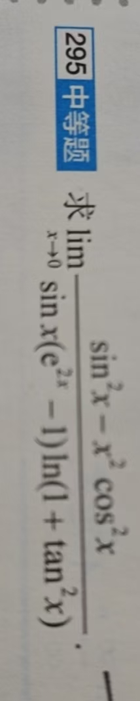

# 题目讲解 · 2026-10-08_11-56-58

- 记录时间：2026-10-08 11:56:58
- 时区：Asia/Shanghai（UTC+08:00）
- 原图：photo/2026-10-08_11-56-58.jpg
- Notion 同步状态：已同步；2026年 → 10月 → 08日 → 第 295 题 · 题干/解析
- Notion 页面：[local-question-bank](https://www.notion.so/3e4867d026d980a9b79ce8eeb831631a)

## 第 295 题

### 原题与题图

**295 中等题**：求

$$
\lim_{x\to0}\frac{\sin^2x-x^2\cos^2x}{\sin x(e^{2x}-1)\ln(1+\tan^2x)}.
$$

### 条件与前提检查

题目条件完整。指数为 $2x$，分母为三个因子的乘积，极限方向为 $x\to0$，包含左右两侧。

在充分小的去心邻域（靠近 $0$ 且排除 $0$）内，$\cos x\ne0$，所以 $\tan x$ 有定义；$1+\tan^2x>0$，对数有定义。三个分母因子在此邻域均不为零。

### 解题思路

要求一个 $0/0$ 型极限。分子两项的二次项会相互抵消，因此需要展开到四次项；分母是乘积，可以分别使用等价无穷小。

“等价无穷小”表示两个趋于零的量，其比值趋于 $1$。记号 $o(x^k)$ 表示比 $x^k$ 更高阶的余项，即它除以 $x^k$ 后趋于 $0$。

### 详细解析

**1. 先确定分母的阶数。**

由基本极限，当 $x\to0$ 时，

$$
\sin x\sim x,\qquad e^{2x}-1\sim2x,\qquad \tan x\sim x.
$$

又因为 $\ln(1+u)\sim u$（$u\to0$），令 $u=\tan^2x$，得到

$$
\ln(1+\tan^2x)\sim\tan^2x\sim x^2.
$$

各因子相乘，便有

$$
\sin x(e^{2x}-1)\ln(1+\tan^2x)\sim x\cdot2x\cdot x^2=2x^4.
$$

因此要找到分子中 $x^4$ 的系数。

**2. 展开分子，保留抵消后的首个非零项。**

Taylor 展开给出

$$
\sin x=x-\frac{x^3}{6}+o(x^3),\qquad
\cos x=1-\frac{x^2}{2}+o(x^2).
$$

将正弦展开式平方，交叉项贡献 $-x^4/3$，其余项属于 $o(x^4)$：

$$
\sin^2x=\left(x-\frac{x^3}{6}+o(x^3)\right)^2
=x^2-\frac{x^4}{3}+o(x^4).
$$

同样，先将余弦平方，再乘以 $x^2$：

$$
\cos^2x=1-x^2+o(x^2),\qquad
x^2\cos^2x=x^2-x^4+o(x^4).
$$

相减时注意括号前的负号：

$$
\begin{aligned}
\sin^2x-x^2\cos^2x
&=\left(x^2-\frac{x^4}{3}+o(x^4)\right)
-\left(x^2-x^4+o(x^4)\right)\\
&=\frac23x^4+o(x^4).
\end{aligned}
$$

二次项恰好抵消，留下的四次项系数为 $1-1/3=2/3$。

**3. 分子、分母同时除以 $x^4$，计算极限。**

分子除以 $x^4$ 趋于 $2/3$，分母除以 $x^4$ 趋于 $2$。分母的极限非零，可以使用商的极限法则：

$$
\lim_{x\to0}\frac{\sin^2x-x^2\cos^2x}{\sin x(e^{2x}-1)\ln(1+\tan^2x)}
=\frac{\frac23}{2}=\frac13.
$$

### 最终答案

$$
\boxed{\frac13}
$$

### 检验与易错点

- 左右两侧均适用上述展开。分子和分母的首项都含 $x^4$，系数均为正，与正的有限极限一致。
- 独立核对分子：利用 $\sin^2x=(1-\cos2x)/2$ 和 $\cos^2x=(1+\cos2x)/2$，代入 $\cos2x=1-2x^2+\frac23x^4+o(x^4)$，仍得到 $\frac23x^4+o(x^4)$。
- 分子的最低阶项抵消，直接把 $\sin^2x$ 替成 $x^2$、把 $x^2\cos^2x$ 替成 $x^2$，会丢失决定答案的四次项。
- $e^{2x}-1\sim2x$，系数 $2$ 必须保留。
- $\ln(1+\tan^2x)\sim x^2$，其阶数为二次；分母总阶数为四次。
