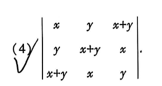
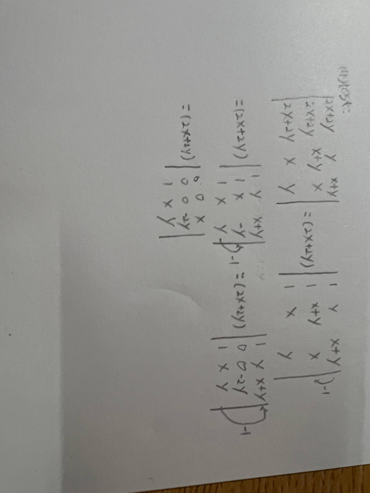

# 题目讲解 · 2026-10-11_22-54-14

- 记录时间：2026-10-11 22:54:14
- 时区：Asia/Shanghai（UTC+08:00）
- 原图：题目 `photo/2026-10-11_22-54-14.png`；手写过程 `photo/2026-10-11_22-54-14_02.jpg`
- Notion 同步状态：已同步；2026年 → 10月 → 11日 → 第 4 题（题干/解析）。
- Notion 页面：[local-question-bank](https://app.notion.com/p/3e4867d026d980a9b79ce8eeb831631a?pvs=204)

## 第 4 题

### 原题与题图

用户问题：我哪错了？

图片标号为（4），给出的行列式为：

$$
D=\begin{vmatrix}
x&y&x+y\\
y&x+y&x\\
x+y&x&y
\end{vmatrix}.
$$

手写过程先把第二、第三列加到第一列，提取第一列公因子 $2x+2y$，得到第一列全为 $1$ 的行列式。下一步第二行写成 $(1,x,-y)$，随后第二行写成 $(0,0,-2y)$，最后第一行写成 $(0,0,x)$。

### 条件与前提检查

题目给出全部九个元素，足以计算。图片没有给出 $x,y$ 的取值限制，不额外假设它们非零，也不假设 $x+y\ne0$。手写箭头没有逐项标出全部行变换；由第二行后两项的变化可识别其意图为第二行减去第一行。

### 解题思路

已知三阶行列式和手写变形过程，需要找出第一次错误并计算正确结果。先利用“把另一列加到某列，行列式不变”和“某列有公因子，可以提到行列式外”简化第一列，再逐项执行行减法，沿含两个零的第一列展开。

用 $C_i$ 表示第 $i$ 列，用 $R_i$ 表示第 $i$ 行；箭头表示用运算结果替换该列或该行，其他行列保留。

### 详细解析

**1. 合并第一列并提取公因子：这两步正确。**

执行 $C_1\leftarrow C_1+C_2+C_3$ 后，每行第一项都变成 $2x+2y$，因此：

$$
D=\begin{vmatrix}
2x+2y&y&x+y\\
2x+2y&x+y&x\\
2x+2y&x&y
\end{vmatrix}
=(2x+2y)\begin{vmatrix}
1&y&x+y\\
1&x+y&x\\
1&x&y
\end{vmatrix}.
$$

提取公因子依据行列式对一列的线性性质，等式在 $x+y=0$ 时也成立，过程中无需除以 $2x+2y$。

**2. 第一次错误：第二行减去第一行时，第一项漏减。**

执行 $R_2\leftarrow R_2-R_1$，三个位置必须一起计算：

$$
(1,x+y,x)-(1,y,x+y)
=(1-1,(x+y)-y,x-(x+y))
=(0,x,-y).
$$

手写的 $(1,x,-y)$ 中，第一项应为 $0$。后面继续用这行计算，会把错误传递下去。

**3. 末步还有一个独立的漏算。**

如果第一行减去图中仍为 $(1,x,y)$ 的第三行，应当得到：

$$
(1,y,x+y)-(1,x,y)=(0,y-x,x).
$$

第二项是 $y-x$，题目没有给出 $x=y$，不能把它直接写成 $0$。

**4. 沿原思路完成正确计算。**

在提取公因子后的行列式中，执行 $R_2\leftarrow R_2-R_1$ 和 $R_3\leftarrow R_3-R_1$；两次都使用保留不变的第一行：

$$
R_2=(0,x,-y),\qquad
R_3=(1,x,y)-(1,y,x+y)=(0,x-y,-x).
$$

因此：

$$
D=(2x+2y)\begin{vmatrix}
1&y&x+y\\
0&x&-y\\
0&x-y&-x
\end{vmatrix}.
$$

沿第一列展开，下面两项均为零，只剩第一项。第一行第一列对应的符号为 $(-1)^{1+1}=1$，二阶行列式按“主对角线乘积减去另一条对角线乘积”计算：

$$
\begin{aligned}
D&=(2x+2y)\begin{vmatrix}x&-y\\x-y&-x\end{vmatrix}\\
&=(2x+2y)\bigl[x(-x)-(-y)(x-y)\bigr]\\
&=2(x+y)(-x^2+xy-y^2)\\
&=-2(x+y)(x^2-xy+y^2)\\
&=-2(x^3+y^3).
\end{aligned}
$$

最后一步使用立方和公式 $(x+y)(x^2-xy+y^2)=x^3+y^3$。

### 最终答案

$$
\boxed{D=-2(x^3+y^3)}.
$$

第一次错误是第二行减去第一行后，把第一项 $1-1=0$ 写成了 $1$；末步第一行减去第三行时，第二项应保留为 $y-x$。

### 检验与易错点

按原行列式的第一行直接展开，独立得到：

$$
\begin{aligned}
D&=x\bigl[y(x+y)-x^2\bigr]
-y\bigl[y^2-x(x+y)\bigr]
+(x+y)\bigl[xy-(x+y)^2\bigr]\\
&=3xy(x+y)-x^3-y^3-(x+y)^3\\
&=-2(x^3+y^3).
\end{aligned}
$$

- 取 $x=1,y=0$，原行列式为 $-2$，答案也为 $-2$。
- 取 $x=y=1$，原行列式为 $-4$，答案也为 $-4$。
- 当 $x+y=0$ 时，三列之和为零，原行列式为零；答案也为零，没有遗漏此情况。
- 一行减去另一行时，每个位置都要参与运算，包括第一列的 $1$。
- 不能因为想得到零，就把 $y-x$ 当成零；必须有题目条件或可证明的依据。
- 使用已经更新的行继续运算时，必须使用该行当前的全部元素。
