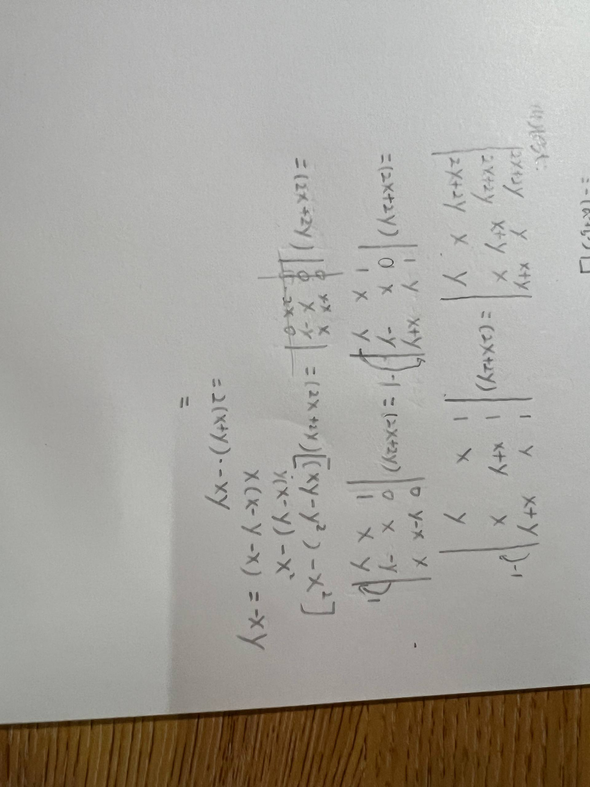

# 题目讲解 · 2026-10-11_23-01-16

- 记录时间：2026-10-11 23:01:16
- 时区：Asia/Shanghai（UTC+08:00）
- 原图：`photo/2026-10-11_23-01-16.jpg`
- 关联解析：[第 4 题](2026-10-11_22-54-14.md)
- Notion 同步状态：已同步；补充到 2026年 → 10月 → 11日 → 第 4 题 · 解析，未重复创建题目。
- Notion 页面：[local-question-bank](https://app.notion.com/p/3e4867d026d980a9b79ce8eeb831631a?pvs=204)

## 第 4 题

### 原题与题图

原题为计算行列式：

$$
D=\begin{vmatrix}
x&y&x+y\\
y&x+y&x\\
x+y&x&y
\end{vmatrix}.
$$

本次上传的是修改后的手写过程，用于继续检查计算。

提取第一列公因子并做行减法后，手写得到：

$$
D=(2x+2y)\begin{vmatrix}
0&y-x&x\\
0&x&-y\\
1&x&y
\end{vmatrix}.
$$

接着给第三行加上第二行，得到第三行 $(1,2x,0)$，沿第一列展开为 $(2x+2y)[(xy-y^2)-x^2]$。随后把 $y(x-y)-x^2$ 写成 $-xy$。

### 条件与前提检查

这是同一道第 4 题。原题未给出 $x=y$ 等附加条件，本次前面的行变换与行列式展开均正确。第一列中第三行的 $1$ 清晰，部分划线不影响展开式的判断。无需假设 $x+y\ne0$。

### 解题思路

已知当前正确的展开式，需要定位余下的代数错误。先逐项展开 $y(x-y)$，再确认哪些项能够合并；最后提出负号并使用立方和公式完成化简。

### 详细解析

**1. 当前行变换与展开正确。**

以提取公因子后的行列式为起点，执行 $R_2\leftarrow R_2-R_1$ 和 $R_1\leftarrow R_1-R_3$，分别得到 $(0,x,-y)$ 和 $(0,y-x,x)$。再执行 $R_3\leftarrow R_3+R_2$，第三行变成 $(1,2x,0)$。这些行运算都保持行列式的值不变。

沿第一列展开，只有第三行的 $1$ 留下，其符号为 $(-1)^{3+1}=1$。删去第三行与第一列，得到：

$$
\begin{aligned}
D&=(2x+2y)\begin{vmatrix}y-x&x\\x&-y\end{vmatrix}\\
&=(2x+2y)\bigl[(y-x)(-y)-x^2\bigr]\\
&=(2x+2y)(xy-y^2-x^2).
\end{aligned}
$$

手写中这一行的结果正确。

**2. 错误在最后把三个不同的项合并。**

$$
y(x-y)-x^2=xy-y^2-x^2.
$$

$xy$、$y^2$、$x^2$ 的字母及指数不同，它们不是同类项，不能直接相消或合并为 $-xy$。

只有额外满足 $x=y$ 时，$xy-y^2-x^2=-xy$ 才成立。因为两式之差为：

$$
(xy-y^2-x^2)-(-xy)=2xy-y^2-x^2=-(x-y)^2.
$$

原题没有这个附加条件，因此不能采用该化简。

**3. 正确的最后几步。**

$$
\begin{aligned}
D&=2(x+y)(xy-y^2-x^2)\\
&=-2(x+y)(x^2-xy+y^2)\\
&=\boxed{-2(x^3+y^3)}.
\end{aligned}
$$

第二步提出负号，括号内每一项都要改变符号；第三步使用 $(x+y)(x^2-xy+y^2)=x^3+y^3$。

### 最终答案

当前行变换和展开都正确，错误仅在最后化简。应保留 $xy-y^2-x^2$，最终得到：

$$
\boxed{D=-2(x^3+y^3)}.
$$

### 检验与易错点

- 取 $x=1,y=0$，$y(x-y)-x^2=-1$，而 $-xy=0$，直接证明这一步通常不成立。
- 同类项要求字母部分及各字母的指数完全相同；$xy$、$x^2$、$y^2$ 不能直接合并。
- 沿第一列展开时，本题非零元素在第三行，符号仍为正。
- 提出负号时，括号内所有项都要变号。
