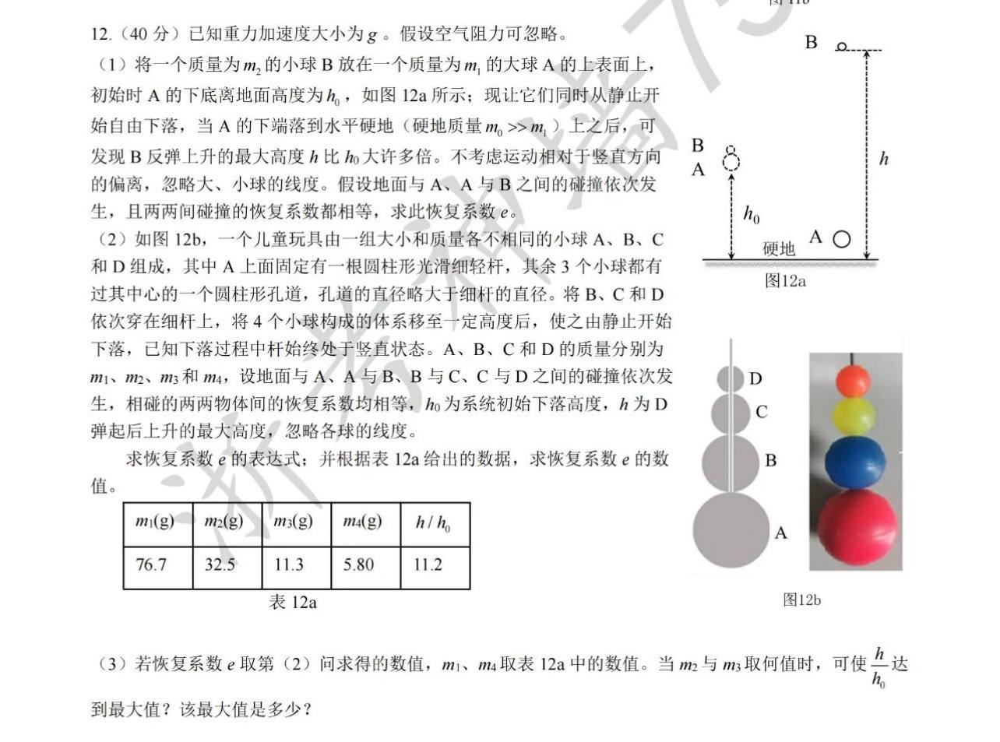

# 题目讲解 · 2026-10-12_22-44-33

- 记录时间：2026-10-12 22:44:33
- 时区：Asia/Shanghai（UTC+08:00）
- 原图：`photo/2026-10-12_22-44-33.jpg`
- Notion 同步状态：已同步，2026年 → 10月 → 12日 → 第 12 题 · 题干／解析；本次新增正文、层级与 37 个独立公式已复读核对。
- Notion 页面：[local-question-bank](https://www.notion.so/3e4867d026d980a9b79ce8eeb831631a)

## 第 12 题 · 碰撞与弹跳高度

### 原题与题图

**12．（40 分）** 已知重力加速度大小为 $g$。假设空气阻力可忽略。

（1）将一个质量为 $m_2$ 的小球 B 放在一个质量为 $m_1$ 的大球 A 的上表面上，初始时 A 的下底离地面高度为 $h_0$，如图 12a 所示；现让它们同时从静止开始自由下落，当 A 的下端落到水平硬地（硬地质量 $m_0\gg m_1$）上之后，可发现 B 反弹上升的最大高度 $h$ 比 $h_0$ 大许多倍。不考虑运动相对于竖直方向的偏离，忽略大、小球的线度。假设地面与 A、A 与 B 之间的碰撞依次发生，且两两间碰撞的恢复系数都相等，求此恢复系数 $e$。

（2）如图 12b，一个儿童玩具由一组大小和质量各不相同的小球 A、B、C 和 D 组成，其中 A 上面固定有一根圆柱形光滑细轻杆，其余 3 个小球都有过其中心的一个圆柱形孔道，孔道的直径略大于细杆的直径。将 B、C 和 D 依次穿在细杆上，将 4 个小球构成的体系移至一定高度后，使之由静止开始下落，已知下落过程中杆始终处于竖直状态。A、B、C 和 D 的质量分别为 $m_1,m_2,m_3,m_4$，设地面与 A、A 与 B、B 与 C、C 与 D 之间的碰撞依次发生，相碰的两两物体间的恢复系数均相等，$h_0$ 为系统初始下落高度，$h$ 为 D 弹起后上升的最大高度，忽略各球的线度。

求恢复系数 $e$ 的表达式；并根据表 12a 给出的数据，求恢复系数 $e$ 的数值。

| $m_1$（g） | $m_2$（g） | $m_3$（g） | $m_4$（g） | $h/h_0$ |
| --- | --- | --- | --- | --- |
| 76.7 | 32.5 | 11.3 | 5.80 | 11.2 |

（3）若恢复系数 $e$ 取第（2）问求得的数值，$m_1,m_4$ 取表 12a 中的数值。当 $m_2$ 与 $m_3$ 取何值时，可使 $h/h_0$ 达到最大值？该最大值是多少？

**图示信息：** 图 12a 中 B 在 A 上方，初始下落高度标为 $h_0$，B 弹起后的最高位置距地面为 $h$；图 12b 中四球自下而上为 A、B、C、D，细杆固定在 A 上，穿过另外三个球的中心孔道。图中的大小和距离比例不用于计算。

### 条件与前提检查

- 三问条件与表格数据清楚，恢复系数是各次碰撞共同的 $e$。普通被动碰撞满足 $0\le e\le1$。
- 按 $m_0\gg m_1$ 将硬地视为静止的固定地面，忽略地面的反冲；第（1）问另列保留有限 $m_0$ 时的结果。
- 采用题目给定的依次碰撞模型，碰撞时间与各次碰撞间的时间忽略不计，因此未参加碰撞的上方球仍以初始落地速度向下运动。
- 杆光滑且轻，忽略杆的质量及其沿竖直方向的摩擦作用。忽略球的线度后，各球碰撞位置的高度差也忽略，所以弹起高度由碰撞后的向上速度决定。
- 碰撞过程中对相碰两球使用动量守恒，忽略短暂碰撞期间重力的冲量。恢复系数小于 1 时，碰撞前后的机械能一般不守恒。
- 下文关于高度的公式用于上方球碰后向上运动的情况；求 $e$ 时必须选择对应的正速度，不能把向下的速度平方后当作弹起高度。

### 解题思路

已知下落高度、球的质量以及弹起高度，要求碰撞的恢复系数和最佳质量配置。

先由自由落体求各球落地前的共同速率。每次球间碰撞同时列动量守恒与恢复系数方程，求出上方球的速度。第（2）问把该关系连续使用三次；第（3）问把影响速度的质量因子改写为相邻质量比，用均值不等式证明其最大值。

### 详细解析

**共同准备：速度方向和碰撞公式。**

取竖直向上为正，记落地前共同的速率为 $v$。从静止下落高度 $h_0$，有

$$
v=\sqrt{2gh_0}.
$$

因此每个球在首次碰撞前的速度为 $-v$。若某球从接近地面的碰撞位置以向上速度 $U>0$ 弹起，则最高点速度为零，由竖直上抛运动得

$$
h=\frac{U^2}{2g},\qquad \frac{U}{v}=\sqrt{\frac{h}{h_0}}.
$$

恢复系数 $e$ 表示“碰后相互分离的速率”与“碰前相互接近的速率”之比。

设下方球质量为 $M$，碰前速度为 $u$；上方球质量为 $m$，碰前速度为 $-v$。碰后速度分别为 $u'$ 和 $w$。碰前两球的接近速率是 $u+v$，碰后分离速率是 $w-u'$，所以

$$
\begin{cases}
Mu-mv=Mu'+mw,\\
w-u'=e(u+v).
\end{cases}
$$

由第二式得 $u'=w-e(u+v)$，代入第一式：

$$
(M+m)w=(1+e)Mu+(eM-m)v.
$$

整理为便于连续使用的形式：

$$
\boxed{w+v=(1+e)\frac{M}{M+m}(u+v)}.
$$

这里 $w+v$ 是上方球碰后速度相对于其原来向下速度 $-v$ 的增加量。

**（1）两球：求恢复系数。**

A 与固定地面碰撞，碰前速度为 $-v$，碰后速度为 $ev$。随后 A 与 B 相碰，此时 B 仍为 $-v$。

在共同公式中取 $M=m_1,m=m_2,u=ev$，得到 B 的碰后速度 $U_B$：

$$
U_B+v=(1+e)\frac{m_1}{m_1+m_2}(ev+v)
=(1+e)^2\frac{m_1}{m_1+m_2}v.
$$

因此

$$
U_B=\left[(1+e)^2\frac{m_1}{m_1+m_2}-1\right]v.
$$

B 向上弹起，故取 $U_B/v=\sqrt{h/h_0}$，得到

$$
1+\sqrt{\frac{h}{h_0}}=(1+e)^2\frac{m_1}{m_1+m_2}.
$$

解得固定地面近似下的答案：

$$
\boxed{e=\sqrt{\frac{m_1+m_2}{m_1}\left(1+\sqrt{\frac{h}{h_0}}\right)}-1}.
$$

若保留地面的有限质量 $m_0$，由地面与 A 的动量守恒和恢复系数可得 A 的碰后速度为

$$
u_A=\frac{em_0-m_1}{m_0+m_1}v.
$$

将该速度代入 A、B 的碰撞公式，则

$$
\boxed{e=\sqrt{\frac{(m_0+m_1)(m_1+m_2)}{m_0m_1}\left(1+\sqrt{\frac{h}{h_0}}\right)}-1}.
$$

当 $m_0\gg m_1$ 时，$(m_0+m_1)/m_0\approx1$，即回到前面的固定地面结果。

**（2）四球：建立速度递推并计算 $e$。**

记 $u_1,u_2,u_3,u_4$ 分别为 A、B、C、D 在与其下方物体碰撞后、尚未与上方物体碰撞时的速度；D 上方没有球。先有 $u_1=ev$。

依次使用共同公式：

$$
\begin{aligned}
u_2+v&=(1+e)\frac{m_1}{m_1+m_2}(u_1+v),\\
u_3+v&=(1+e)\frac{m_2}{m_2+m_3}(u_2+v),\\
u_4+v&=(1+e)\frac{m_3}{m_3+m_4}(u_3+v).
\end{aligned}
$$

又因为 $u_1+v=(1+e)v$，所以连续代入得到

$$
u_4+v=(1+e)^4\frac{m_1m_2m_3}{(m_1+m_2)(m_2+m_3)(m_3+m_4)}v.
$$

令

$$
P=\frac{m_1m_2m_3}{(m_1+m_2)(m_2+m_3)(m_3+m_4)}.
$$

D 的弹起速度为

$$
u_4=\big[(1+e)^4P-1\big]v.
$$

因为 D 向上弹起，所以

$$
1+\sqrt{\frac{h}{h_0}}=(1+e)^4P.
$$

由此得

$$
\boxed{e=\left[\left(1+\sqrt{\frac{h}{h_0}}\right)\frac{(m_1+m_2)(m_2+m_3)(m_3+m_4)}{m_1m_2m_3}\right]^{1/4}-1}.
$$

代入表格数据。质量只出现在比值中，因此可以统一使用 g，不必另外换成 kg：

$$
P=\frac{76.7\times32.5\times11.3}{(76.7+32.5)(32.5+11.3)(11.3+5.80)}
\approx0.344400925.
$$

于是

$$
e=\left(\frac{1+\sqrt{11.2}}{0.344400925}\right)^{1/4}-1
\approx0.884830685.
$$

所以

$$
\boxed{e\approx0.885}.
$$

**（3）确定 $m_2,m_3$，使高度比最大。**

固定 $e,m_1,m_4$ 时，在 D 向上弹起的范围内，$P$ 越大，$u_4$ 越大，弹起高度越大。因此只需最大化 $P$。

引入三个正的相邻质量比：

$$
x=\frac{m_2}{m_1},\qquad y=\frac{m_3}{m_2},\qquad z=\frac{m_4}{m_3}.
$$

它们的乘积固定：

$$
xyz=\frac{m_4}{m_1}=k.
$$

质量因子化为

$$
P=\frac1{(1+x)(1+y)(1+z)}.
$$

最大化 $P$，等价于最小化分母。展开分母：

$$
(1+x)(1+y)(1+z)=1+(x+y+z)+(xy+yz+zx)+k.
$$

对正数使用算术平均数不小于几何平均数的不等式：

$$
x+y+z\ge3\sqrt[3]{xyz}=3k^{1/3}.
$$

同样，因为 $(xy)(yz)(zx)=k^2$，有

$$
xy+yz+zx\ge3\sqrt[3]{k^2}=3k^{2/3}.
$$

相加得到

$$
(1+x)(1+y)(1+z)\ge1+3k^{1/3}+3k^{2/3}+k
=(1+k^{1/3})^3.
$$

两条不等式都在 $x=y=z=k^{1/3}$ 时取等号，所以该下界可以达到，给出了全局最大值。设

$$
q=\left(\frac{m_4}{m_1}\right)^{1/3},
$$

最优条件是

$$
\boxed{\frac{m_2}{m_1}=\frac{m_3}{m_2}=\frac{m_4}{m_3}=q}.
$$

也就是四个质量依次成等比数列。因此

$$
\boxed{m_2=m_1^{2/3}m_4^{1/3},\qquad m_3=m_1^{1/3}m_4^{2/3}}.
$$

代入 $m_1=76.7\,\mathrm g,m_4=5.80\,\mathrm g$：

$$
q=\left(\frac{5.80}{76.7}\right)^{1/3}\approx0.422873896,
$$

$$
\boxed{m_2\approx32.43\,\mathrm g,\qquad m_3\approx13.72\,\mathrm g}.
$$

此时

$$
P_{\max}=\frac1{(1+q)^3}.
$$

将第（2）问未舍入的 $e\approx0.884830685$ 代入，得到

$$
\boxed{\left(\frac h{h_0}\right)_{\max}
=\left[\frac{(1+e)^4}{\left(1+\sqrt[3]{m_4/m_1}\right)^3}-1\right]^2
\approx11.4323\approx11.43}.
$$

### 最终答案

（1）固定地面近似下：

$$
\boxed{e=\sqrt{\frac{m_1+m_2}{m_1}\left(1+\sqrt{\frac h{h_0}}\right)}-1}.
$$

（2）四球模型：

$$
\boxed{e=\left[\left(1+\sqrt{\frac h{h_0}}\right)\frac{(m_1+m_2)(m_2+m_3)(m_3+m_4)}{m_1m_2m_3}\right]^{1/4}-1
\approx0.885}.
$$

（3）最优质量为

$$
\boxed{m_2\approx32.43\,\mathrm g,\qquad m_3\approx13.72\,\mathrm g,\qquad
\left(\frac h{h_0}\right)_{\max}\approx11.43}.
$$

### 检验与易错点

- 数值代回：表中质量给出 $u_4/v=\sqrt{11.2}\approx3.34664>0$，高度比为 11.2；恢复系数约为 0.88483，处于 $[0,1]$ 内。
- 最优质量满足三个相邻质量比均约为 0.422874，且 $m_2^3=m_1^2m_4$、$m_3^3=m_1m_4^2$。对应 $u_4/v\approx3.38117>0$，最大高度比 11.4323 大于原来的 11.2。
- 独立逐次两体碰撞计算中，每次球间碰撞都满足动量守恒和恢复系数定义，最终高度比与上述公式一致。
- 质量因子、恢复系数和高度比都无量纲；$h=U^2/(2g)$ 的量纲为长度。
- $e<1$ 时，碰撞会损失机械能，不能把碰撞过程当作机械能守恒。球间碰撞损失的动能为 $\frac12\frac{Mm}{M+m}(1-e^2)(u+v)^2\ge0$。
- 最上方球的高度增大来自其他球向它传递能量；质量较小的球可以获得更大的速率，并不要求系统总能量增加。
- 理想极限检验：两球 $m_2/m_1\to0,e=1$ 时，$U_B/v\to3$，故 $h/h_0\to9$；四球相邻质量比都趋于零且 $e=1$ 时，$u_4/v\to15$，故 $h/h_0\to225$。
- 四球公式中的 $(1+e)^4$ 包含一次地面碰撞和三次球间碰撞。记住上方尚未碰撞的球仍以 $-v$ 下落。
- 求最大值时，均值不等式的等号条件给出等比质量配置；不能仅凭示意图中的球大小推断最优质量。
- 以上结果采用题目给定的依次碰撞和忽略线度模型。实际球的变形、有限碰撞时间与额外碰撞会改变该模型的适用范围。
