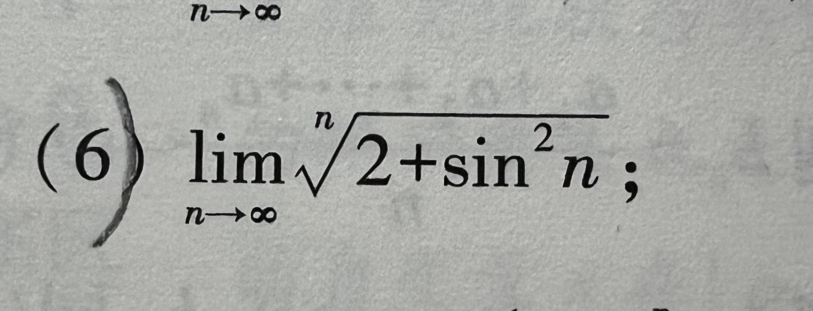

# 题目讲解 · 2026-10-15_00-23-15

- 记录时间：2026-10-15 00:23:15
- 时区：Asia/Shanghai（UTC+08:00）
- 原图：`photo/2026-10-15_00-23-15.jpg`
- Notion 同步状态：已同步，位于 2026年 → 10月 → 15日 → 第 6 题 · 题干/解析。
- Notion 页面：[local-question-bank](https://app.notion.com/p/3e4867d026d980a9b79ce8eeb831631a?pvs=204)

## 第 6 题

### 原题与题图

求极限：

$$
\lim_{n\to\infty}\sqrt[n]{2+\sin^2n}.
$$

### 条件与前提检查

$n$ 为趋于正无穷的正整数，根号左上角的 $n$ 表示取 $n$ 次方根。$\sin^2n$ 表示 $(\sin n)^2$。根号内的数始终为正，正的 $n$ 次方根有定义。题目条件完整。

### 解题思路

已知根号内含有随 $n$ 变化的正弦平方，要求整个根式的极限。先用正弦的取值范围找到固定的上、下界，再取 $n$ 次方根。若上、下界趋于同一个数，中间的数列也趋于这个数，这就是夹逼定理。

### 详细解析

**1. 给根号内的数确定范围。**

对任意 $n$，都有 $-1\le\sin n\le1$，所以

$$
0\le\sin^2n\le1.
$$

每一项都加上 $2$，得到

$$
2\le2+\sin^2n\le3.
$$

**2. 对不等式取 $n$ 次方根。**

对于正整数 $n$，函数 $x^{1/n}$ 在正数范围内单调递增，因此取 $n$ 次方根后，不等号方向不变：

$$
2^{1/n}\le\sqrt[n]{2+\sin^2n}\le3^{1/n}.
$$

**3. 求两端极限，使用夹逼定理。**

对任意固定的正数 $a$，

$$
a^{1/n}=e^{\frac{\ln a}{n}}.
$$

因为 $\ln a$ 是常数，当 $n\to\infty$ 时，$\frac{\ln a}{n}\to0$。指数函数连续，因此

$$
\lim_{n\to\infty}a^{1/n}=e^0=1.
$$

分别取 $a=2$ 和 $a=3$，就有

$$
\lim_{n\to\infty}2^{1/n}=\lim_{n\to\infty}3^{1/n}=1.
$$

中间的根式始终被这两个数列夹住，所以由夹逼定理得到

$$
\lim_{n\to\infty}\sqrt[n]{2+\sin^2n}=1.
$$

### 最终答案

$$
\boxed{1}
$$

### 检验与易错点

- 根号内始终在 $[2,3]$ 中，上、下界均为固定正数，满足上述夹逼条件。
- 每一项都大于 $1$，但仍可以趋于 $1$；极限描述无限接近的数值，不要求某一项等于它。
- 不需要先求 $\sin^2n$ 的极限；内层有波动，仍可通过上下界确定整个根式的极限。
- 根指数也随 $n$ 增大，不能把本题当成固定平方根的极限。
