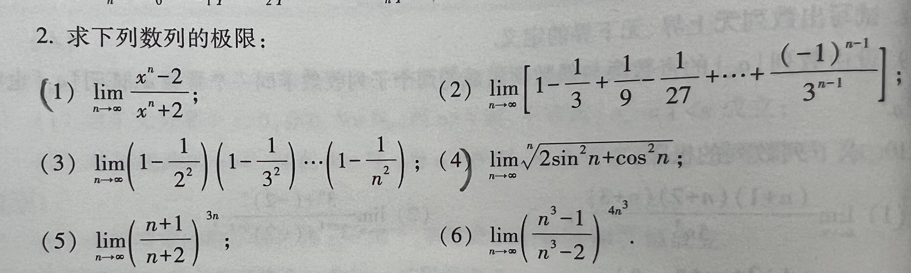

# 题目讲解 · 2026-10-15_10-38-18

- 记录时间：2026-10-15 10:38:18。
- 时区：Asia/Shanghai（UTC+08:00）。
- 原图：[photo/2026-10-15_10-38-18.jpg](photo/2026-10-15_10-38-18.jpg)。
- Notion 同步状态：已同步，已复读本次题干、完整解析、四层嵌套和公式。
- Notion 页面：[local-question-bank](https://www.notion.so/3e4867d026d980a9b79ce8eeb831631a)。
- Notion 归档位置：2026年 → 10月 → 15日 → 第 2 题。

## 第 2 题 · 原题与题图

**2．求下列数列的极限：**

（1）

$$
\lim_{n\to\infty}\frac{x^n-2}{x^n+2}.
$$

（2）

$$
\lim_{n\to\infty}\left[1-\frac13+\frac19-\frac1{27}+\cdots+\frac{(-1)^{n-1}}{3^{n-1}}\right].
$$

（3）

$$
\lim_{n\to\infty}\left(1-\frac1{2^2}\right)\left(1-\frac1{3^2}\right)\cdots\left(1-\frac1{n^2}\right).
$$

（4）

$$
\lim_{n\to\infty}\sqrt[n]{2\sin^2n+\cos^2n}.
$$

（5）

$$
\lim_{n\to\infty}\left(\frac{n+1}{n+2}\right)^{3n}.
$$

（6）

$$
\lim_{n\to\infty}\left(\frac{n^3-1}{n^3-2}\right)^{4n^3}.
$$

## 条件与前提检查

- 六小问的符号及指数清晰。第（4）问取 n 次方根，根号覆盖整个 $2\sin^2n+\cos^2n$；第（6）问指数为 $4n^3$。
- $n$ 为趋于正无穷的正整数；第（3）问按 $n\ge2$ 讨论。
- 第（1）问没有给出 $x$ 的范围，下文按通常的实数情形，将 $x$ 视为固定实参数，完整分类讨论。
- 第（1）问在某些 $x<-1$ 时可能有一个奇数指标使分母为零。对固定 $x$，这样的指标至多一个，充分大的 $n$ 时表达式有定义。以下讨论尾部极限；若要求从第一项起每项都有定义，应排除 $x=-2^{1/(2k+1)}$（$k=0,1,2,\ldots$）。有限个初始项不影响尾部极限。
- 第（4）问被开方数始终为正。第（5）问底数为正；第（6）问在 $n\ge2$ 时底数大于 $1$，可以使用正数幂的运算法则。

## 解题思路

（1）先判断 $x^n$ 的行为；当 $|x|>1$ 时，用分子、分母同除以 $x^n$ 消去大幂次。

（2）把括号内识别为等比数列前 $n$ 项和，先求和再取极限。

（3）把每项用平方差公式分解，约去乘积中的相同因子。

（4）先用三角恒等式化简，再用夹逼定理。

（5）（6）底数趋于 $1$，指数趋于无穷，属于 $1^\infty$ 型，须使用重要极限，保留底数接近 $1$ 的速度。

## 详细解析

### （1）含参数的分式数列

已知 $x$ 固定，要求数列 $a_n=(x^n-2)/(x^n+2)$ 的极限。关键是 $x^n$ 的行为随 $x$ 的范围变化。

**第一种：$|x|<1$。**

绝对值小于 $1$ 的数不断乘方，其绝对值趋于零，所以 $x^n\to0$。分母趋于 $2\ne0$，可以使用商的极限法则：

$$
\lim_{n\to\infty}\frac{x^n-2}{x^n+2}=\frac{0-2}{0+2}=-1.
$$

这包括 $x=0$，以及 $-1<x<0$ 的情形；负数幂的正负交替不会改变其绝对值趋于零的事实。

**第二种：$x=1$。**

对所有 $n$，$x^n=1$，因此

$$
a_n=\frac{1-2}{1+2}=-\frac13.
$$

常数数列的极限就是这个常数。

**第三种：$x=-1$。**

分别检查偶数项与奇数项：

$$
a_{2k}=\frac{1-2}{1+2}=-\frac13,\qquad a_{2k-1}=\frac{-1-2}{-1+2}=-3.
$$

如果整个数列收敛，任何取出的子列都必须趋于同一个极限。这里偶数项恒等于 $-1/3$，奇数项恒等于 $-3$，二者不同，所以极限不存在。

**第四种：$|x|>1$。**

此时 $x\ne0$，分子、分母同除以 $x^n$：

$$
\frac{x^n-2}{x^n+2}=\frac{1-2x^{-n}}{1+2x^{-n}}.
$$

由于 $|1/x|<1$，有 $x^{-n}=(1/x)^n\to0$，因此

$$
\lim_{n\to\infty}\frac{1-2x^{-n}}{1+2x^{-n}}=\frac{1-0}{1+0}=1.
$$

当 $x<-1$ 时，$x^n$ 的正负会交替，但 $x^{-n}$ 仍趋于零，上述变形同样成立。

### （2）等比数列的部分和

记括号内的和为 $S_n$。相邻两项的比值都是 $r=-1/3$，首项为 $1$，从指数 $0$ 到指数 $n-1$，共 $n$ 项。

等比求和公式为

$$
S_n=\frac{a_1(1-r^n)}{1-r},\qquad r\ne1.
$$

它可以由 $S_n-rS_n=a_1-a_1r^n$ 得到：相减后中间项消去，只留下首项和最后一项。

代入 $a_1=1,r=-1/3$：

$$
S_n=\frac{1-(-1/3)^n}{1+1/3}=\frac34\left[1-\left(-\frac13\right)^n\right].
$$

因为 $|-1/3|<1$，所以 $(-1/3)^n\to0$，从而

$$
\lim_{n\to\infty}S_n=\frac34.
$$

### （3）分解因子并约分的乘积

记原乘积为 $P_n$。乘积的因子数随 $n$ 增多，应先求出整个有限乘积的表达式。

对每个整数 $k\ge2$，利用平方差公式：

$$
1-\frac1{k^2}=\frac{k^2-1}{k^2}=\frac{(k-1)(k+1)}{k^2}=\frac{k-1}{k}\cdot\frac{k+1}{k}.
$$

将原乘积拆成两组：

$$
P_n=\left(\frac12\cdot\frac23\cdots\frac{n-1}{n}\right)\left(\frac32\cdot\frac43\cdots\frac{n+1}{n}\right).
$$

第一组的分子 $2,3,\ldots,n-1$ 与分母中的相同因子相约，留下 $1/n$。第二组的 $3,4,\ldots,n$ 相约，留下 $(n+1)/2$。所以

$$
P_n=\frac1n\cdot\frac{n+1}{2}=\frac{n+1}{2n}=\frac12\left(1+\frac1n\right).
$$

令 $n\to\infty$，得到

$$
\lim_{n\to\infty}P_n=\frac12.
$$

### （4）n 次方根与夹逼定理

先用 $\sin^2n+\cos^2n=1$ 化简被开方数：

$$
2\sin^2n+\cos^2n=1+\sin^2n.
$$

因为 $0\le\sin^2n\le1$，所以

$$
1\le2\sin^2n+\cos^2n\le2.
$$

正数取 $n$ 次方根保持大小关系，得到

$$
1\le\sqrt[n]{2\sin^2n+\cos^2n}\le2^{1/n}.
$$

右端的极限为

$$
2^{1/n}=e^{(\ln2)/n}\longrightarrow e^0=1.
$$

两端都趋于 $1$，由夹逼定理，中间数列也趋于 $1$：

$$
\lim_{n\to\infty}\sqrt[n]{2\sin^2n+\cos^2n}=1.
$$

不需要先求 $\sin^2n$ 的极限；固定的正数上下界足以完成夹逼。

### （5）底数小于 1 的重要极限

先看结构：$(n+1)/(n+2)\to1$，而 $3n\to\infty$。这类 $1^\infty$ 型不能仅凭底数趋于 $1$ 就确定极限。

使用重要极限

$$
\lim_{m\to\infty}\left(1+\frac1m\right)^m=e.
$$

其中 $e$ 是自然对数的底数，约为 $2.71828$。为了构造公式，把底数写成倒数：

$$
\frac{n+1}{n+2}=\frac1{1+\frac1{n+1}}.
$$

于是

$$
\left(\frac{n+1}{n+2}\right)^{3n}=\left(1+\frac1{n+1}\right)^{-3n}=\left[\left(1+\frac1{n+1}\right)^{n+1}\right]^{-\frac{3n}{n+1}}.
$$

这一步只把指数拆成 $(n+1)\cdot[-3n/(n+1)]$，乘回去仍是 $-3n$，等式精确成立。

方括号内由重要极限趋于 $e$，外面的指数满足

$$
-\frac{3n}{n+1}\longrightarrow-3.
$$

因为底数趋于正数 $e$，正数幂函数 $A^B=e^{B\ln A}$ 对 $A>0$ 连续，故

$$
\lim_{n\to\infty}\left(\frac{n+1}{n+2}\right)^{3n}=e^{-3}.
$$

### （6）底数大于 1 的重要极限

先把分子写成“分母加 $1$”：

$$
\frac{n^3-1}{n^3-2}=1+\frac1{n^3-2}.
$$

对 $n\ge2$，$n^3-2>0$。为了使用重要极限，在方括号内配上指数 $n^3-2$，同时在外面补上相应倍数：

$$
\left(\frac{n^3-1}{n^3-2}\right)^{4n^3}=\left[\left(1+\frac1{n^3-2}\right)^{n^3-2}\right]^{\frac{4n^3}{n^3-2}}.
$$

方括号内令 $m=n^3-2$，有 $m\to\infty$，因此

$$
\left(1+\frac1{n^3-2}\right)^{n^3-2}\longrightarrow e.
$$

外层指数为

$$
\frac{4n^3}{n^3-2}=\frac4{1-2/n^3}\longrightarrow4.
$$

再次使用正数幂函数的连续性，得到

$$
\lim_{n\to\infty}\left(\frac{n^3-1}{n^3-2}\right)^{4n^3}=e^4.
$$

## 最终答案

（1）按固定实参数 $x$ 讨论尾部极限：

$$
\boxed{\lim_{n\to\infty}\frac{x^n-2}{x^n+2}=\begin{cases}-1,&|x|<1,\\-\frac13,&x=1,\\1,&|x|>1,\\\text{不存在},&x=-1.\end{cases}}
$$

其余五问依次为

$$
\boxed{\text{（2）}\ \frac34;\qquad\text{（3）}\ \frac12;\qquad\text{（4）}\ 1;\qquad\text{（5）}\ e^{-3};\qquad\text{（6）}\ e^4.}
$$

## 检验与易错点

- 第（1）问：$x=-1$ 的奇、偶数项分别为 $-3$ 和 $-1/3$；$x<-1$ 时通过 $x^{-n}\to0$ 仍可求出比值极限。若某个初始指标分母为零，须区分全体项的定义与尾部极限。
- 第（2）问：$n=1$ 时求和式给出 $1$，与原式首项一致；公比为负，分母应为 $1-(-1/3)=4/3$。
- 第（3）问：$n=2$ 时乘积为 $3/4$，公式 $(n+1)/(2n)$ 也为 $3/4$。各因子趋于 $1$，不能直接把因子个数不断增加的乘积判为 $1$。
- 第（4）问：上下界为 $1$ 和 $2^{1/n}$，均趋于 $1$。只知道被开方数有上界还不够，此处还使用了固定的正下界。
- 第（5）问：底数始终位于 $(0,1)$，结果 $e^{-3}$ 也位于 $(0,1)$。令 $u_n=-1/(n+2)$，则 $3nu_n\to-3$；结合 $\ln(1+u)/u\to1$，独立核对对数极限为 $-3$。
- 第（6）问：$n\ge2$ 时底数大于 $1$，结果 $e^4>1$。令 $u_n=1/(n^3-2)$，则 $4n^3u_n\to4$；结合 $\ln(1+u)/u\to1$，独立核对对数极限为 $4$。
