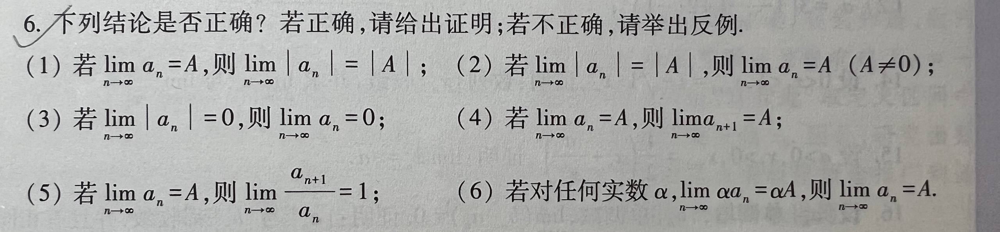

# 题目讲解 · 2026-10-15_11-29-47

- 记录时间：2026-10-15 11:29:47
- 时区：Asia/Shanghai（UTC+08:00）
- 原图：[2026-10-15_11-29-47.jpg](photo/2026-10-15_11-29-47.jpg)
- Notion 同步状态：已同步，已回读核对本次题干、解析、15 个独立公式和行内公式。
- Notion 页面：[local-question-bank](https://www.notion.so/3e4867d026d980a9b79ce8eeb831631a)
- Notion 位置：2026年 → 10月 → 15日 → 第 6 题（2026-10-15_11-29-47）· 题干 / 解析。

## 第 6 题 · 数列极限的六项判断

### 原题与题图

**6．下列结论是否正确？若正确，请给出证明；若不正确，请举出反例。**

（1）若 $\lim_{n\to\infty}a_n=A$，则 $\lim_{n\to\infty}|a_n|=|A|$；

（2）若 $\lim_{n\to\infty}|a_n|=|A|$，则 $\lim_{n\to\infty}a_n=A$（$A\ne0$）；

（3）若 $\lim_{n\to\infty}|a_n|=0$，则 $\lim_{n\to\infty}a_n=0$；

（4）若 $\lim_{n\to\infty}a_n=A$，则 $\lim_{n\to\infty}a_{n+1}=A$；

（5）若 $\lim_{n\to\infty}a_n=A$，则 $\lim_{n\to\infty}\frac{a_{n+1}}{a_n}=1$；

（6）若对任何实数 $\alpha$，$\lim_{n\to\infty}\alpha a_n=\alpha A$，则 $\lim_{n\to\infty}a_n=A$。

### 条件与前提检查

- 按实数数列讨论，$n$ 为正整数，$A$ 为有限实数。
- 第（2）项明确要求 $A\ne0$；第（5）项没有这个限制，必须考虑 $A=0$。
- 第（5）项的商需要分母非零。下文选用每一项都非零的反例，直接检验结论。
- 第（6）项的原文是“对任何实数 $\alpha$”，因此包含 $\alpha=1$。各个 $\alpha$ 都按固定常数处理。
- 本题无额外图示条件，六个命题均可直接判定，无待澄清内容。

### 解题思路

要判断一个“若……则……”命题，先检查它的前提能否保证结论。正确的命题需要证明；错误的命题只需找到一个满足前提、却不满足结论的例子。

第（1）（3）项比较绝对值距离；第（4）项检查向后移动一项是否改变尾部；第（2）（5）项构造简单数列作为反例；第（6）项利用“任何实数”包含的特殊取值。

数列 $a_n$ 收敛于 $A$ 的定义是：任给 $\varepsilon>0$，都能找到正整数 $N$，使所有 $n>N$ 都满足 $|a_n-A|<\varepsilon$。这里 $\varepsilon$ 表示任意小的误差，$N$ 表示从足够靠后的位置开始。

### 详细解析

#### （1）正确：收敛数列取绝对值后仍收敛

已知 $a_n\to A$，要证明 $|a_n|\to|A|$，关键是比较这两个数列与各自极限之间的距离。

三角不等式给出

$$
|a_n|\le|a_n-A|+|A|,\qquad |A|\le|a_n-A|+|a_n|.
$$

分别移项、合并，得到反三角不等式

$$
\bigl||a_n|-|A|\bigr|\le|a_n-A|.
$$

任给 $\varepsilon>0$，由 $a_n\to A$，存在正整数 $N$，当 $n>N$ 时，$|a_n-A|<\varepsilon$。因此

$$
\bigl||a_n|-|A|\bigr|\le|a_n-A|<\varepsilon.
$$

这正是 $|a_n|\to|A|$ 的定义，所以命题正确。

#### （2）错误：绝对值无法确定符号

对任意给定的 $A\ne0$，取常数数列

$$
a_n=-A\qquad(n=1,2,\ldots).
$$

则每一项的绝对值都等于 $|A|$，所以前提成立：

$$
\lim_{n\to\infty}|a_n|=|-A|=|A|.
$$

但这个常数数列的极限为

$$
\lim_{n\to\infty}a_n=-A\ne A.
$$

最后的不等式使用了 $A\ne0$。例如取 $A=1$、$a_n=-1$，就得到最具体的反例。因此命题错误。

#### （3）正确：趋于零时，绝对值就是到零的距离

已知 $|a_n|\to0$，要求证明 $a_n\to0$。直接观察

$$
|a_n-0|=|a_n|=\bigl||a_n|-0\bigr|.
$$

任给 $\varepsilon>0$，由前提可找到正整数 $N$，使 $n>N$ 时 $\bigl||a_n|-0\bigr|<\varepsilon$。根据上面的等式，随即有 $|a_n-0|<\varepsilon$。

因此 $a_n\to0$，命题正确。零没有正、负两个不同的取值，所以本项不会遇到第（2）项中的符号问题。

#### （4）正确：向后移动一项不改变极限

已知 $a_n\to A$。任给 $\varepsilon>0$，存在正整数 $N$，使所有整数指标 $k>N$ 都满足

$$
|a_k-A|<\varepsilon.
$$

当 $n>N$ 时，$n+1>N$，因此可以把 $k=n+1$ 代入，得到

$$
|a_{n+1}-A|<\varepsilon.
$$

这正是数列 $a_{n+1}$ 收敛于 $A$ 的定义，所以命题正确。数列 $a_{n+1}$ 依次取原数列的第二项、第三项、第四项等；删去有限个初始项不会改变极限。

#### （5）错误：极限为零时，相邻项的比值未必趋于 1

取

$$
a_n=\frac1{2^n},\qquad A=0.
$$

这是公比为 $1/2$ 的等比数列，因此 $a_n\to0=A$，满足前提。每一项均大于零，所以下面的商始终有定义：

$$
\frac{a_{n+1}}{a_n}=\frac{2^{-(n+1)}}{2^{-n}}=\frac12.
$$

于是

$$
\lim_{n\to\infty}\frac{a_{n+1}}{a_n}=\frac12\ne1.
$$

因此原命题错误。将分子、分母的极限都代成 $0$ 只能得到 $0/0$ 型，商的极限法则在分母极限为零时不能直接使用。

**补充成立条件。** 如果增加 $A\ne0$，由第（4）项有 $a_{n+1}\to A$。又因为 $a_n\to A\ne0$，充分大的 $n$ 满足

$$
|a_n-A|<\frac{|A|}{2},\qquad |a_n|\ge|A|-|a_n-A|>\frac{|A|}{2}>0.
$$

所以尾部的商有定义，可以使用商的极限法则：

$$
\lim_{n\to\infty}\frac{a_{n+1}}{a_n}=\frac{A}{A}=1.
$$

#### （6）正确：取 α＝1 即可

已知等式对任何实数 $\alpha$ 都成立，特别地，它对 $\alpha=1$ 成立，因此

$$
\lim_{n\to\infty}(1\cdot a_n)=1\cdot A,
$$

也就是 $\lim_{n\to\infty}a_n=A$。所以命题正确。

取 $\alpha=0$ 只会得到恒等式 $0=0$；本题能够推出结论，是因为前提也包含 $\alpha=1$。

### 最终答案

- （1）正确：利用反三角不等式 $\bigl||a_n|-|A|\bigr|\le|a_n-A|$。
- （2）错误：取 $a_n=-A$，其中 $A\ne0$。
- （3）正确：利用 $|a_n-0|=\bigl||a_n|-0\bigr|$。
- （4）正确：$n>N$ 时也有 $n+1>N$，应用极限定义。
- （5）错误：取 $a_n=2^{-n}$，极限为 $0$，相邻项比值恒为 $1/2$。
- （6）正确：在“任何实数 $\alpha$”中取 $\alpha=1$。

### 检验与易错点

- 第（2）项反例同时满足 $A\ne0$ 和绝对值的极限条件；结论失败的原因是 $-A\ne A$。
- 第（5）项反例的分母对每个正整数 $n$ 都非零；其前提成立、结论失败，足以否定原命题。
- 第（1）（3）（4）项的证明对 $A=0$ 的相关情形同样适用；第（5）项若增加 $A\ne0$ 则成立，不能漏看这个条件。
- 第（6）项必须保留“任何”的量词，取 $\alpha=1$ 已经给出完整证明。
