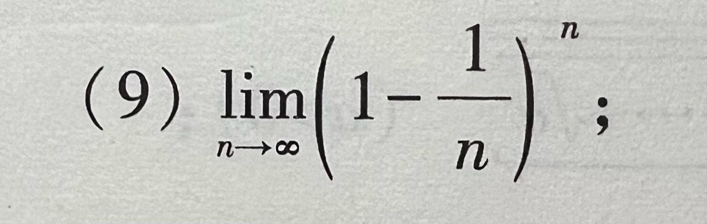

# 题目讲解 · 2026-10-19_01-25-45

- 记录时间：2026-10-19 01:25:45。
- 时区：Etc/UTC（UTC+00:00）。
- 原图：`photo/2026-10-19_01-25-45.jpg`。
- Notion 同步状态：已同步；已复读核对 2026年 → 10月 → 19日 → 第 9 题的题干、完整解析与公式。
- Notion 页面：[local-question-bank](https://www.notion.so/3e4867d026d980a9b79ce8eeb831631a)。

## 第（9）题

### 原题与题图

求极限：

$$
\lim_{n\to\infty}\left(1-\frac1n\right)^n.
$$

### 条件与前提检查

题目清晰、条件完整。$n$ 为正整数；当 $n\ge2$ 时，底数介于 $0$ 与 $1$ 之间。极限只取决于后面的项，因此变形时可以取 $n\ge2$。

### 解题思路

已知底数趋于 $1$、指数趋于无穷，要求整个幂的极限。这是 $1^\infty$ 型未定式，不能直接把底数换成 $1$。把底数改写成一个倒数，再令 $m=n-1$，即可使用基本极限：

$$
\lim_{m\to\infty}\left(1+\frac1m\right)^m=e.
$$

### 详细解析

**第一步：改写底数。** 当 $n\ge2$ 时，

$$
1-\frac1n=\frac{n-1}{n}=\left(1+\frac1{n-1}\right)^{-1}.
$$

所以原式中的每一项可以写成

$$
\left(1-\frac1n\right)^n=\left(1+\frac1{n-1}\right)^{-n}.
$$

**第二步：换元并拆开指数。** 令 $m=n-1$，则 $m\to\infty$，且 $-n=-(m+1)=-m-1$。因此

$$
\left(1-\frac1n\right)^n=\left[\left(1+\frac1m\right)^m\right]^{-1}\left(1+\frac1m\right)^{-1}.
$$

**第三步：分别求极限。** 第一个因子中，方括号内趋于 $e$，而 $e\ne0$，所以它的倒数趋于 $1/e$；第二个因子趋于 $1$。由乘积的极限法则，

$$
\lim_{n\to\infty}\left(1-\frac1n\right)^n=\frac1e\cdot1=\frac1e.
$$

### 最终答案

$$
\boxed{\frac1e}
$$

### 检验与易错点

- 当 $n\ge2$ 时，各项在 $0$ 与 $1$ 之间，答案 $1/e$ 也在这个范围内。
- 核对换元：$m=n-1$ 时，指数是 $-(m+1)$，必须保留额外的因子 $(1+1/m)^{-1}$，然后说明它趋于 $1$。
- $1^\infty$ 是未定式；底数趋于 $1$ 不代表整个幂趋于 $1$。

### 补充：对手写解法的核对

**可以，先凑基本极限再取倒数的方法成立。** 照片中分数附近的正负号较挤，下面按原题规范写成 $1-\frac1n=1+(-\frac1n)$，不把底数改为 $1+\frac1n$。

当 $n\ge2$ 时底数为正，可以使用幂的运算法则：

$$
\left(1-\frac1n\right)^n=\left[\left(1-\frac1n\right)^{-n}\right]^{-1}.
$$

令 $t=-1/n$，则 $t\to0^-$，且 $1/t=-n$。使用两侧均成立的基本极限：

$$
\lim_{t\to0}(1+t)^{1/t}=e.
$$

因此方括号内的极限为

$$
\lim_{n\to\infty}\left(1-\frac1n\right)^{-n}=\lim_{t\to0^-}(1+t)^{1/t}=e.
$$

因为 $e\ne0$，取倒数得到

$$
\lim_{n\to\infty}\left[\left(1-\frac1n\right)^{-n}\right]^{-1}=e^{-1}=\frac1e.
$$

**检验与易错点：** 内外指数相乘为 $(-n)(-1)=n$，变形与原式一致。如果底数写成 $1+1/n$，内外指数仍为 $-n$ 和 $-1$，则整个式子会变成 $(1+1/n)^n$，极限为 $e$，不再是原题。手写时把底数中的负号写清楚即可。

补充原图及逐项核对见[手写解法核对记录](2026-10-19_01-29-22.md)。
