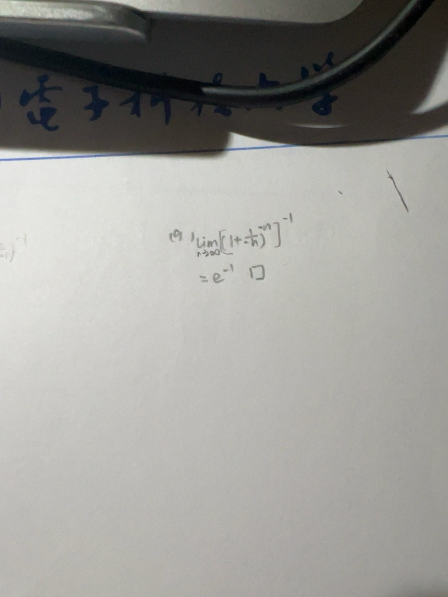

# 题目讲解 · 2026-10-19_01-29-22

- 记录时间：2026-10-19 01:29:22。
- 时区：Etc/UTC（UTC+00:00）。
- 原图：`photo/2026-10-19_01-29-22.jpg`。
- Notion 同步状态：已同步；已复读核对 2026年 → 10月 → 19日已有第 9 题解析中的补充说明及 4 个独立公式，未重复创建题目。
- Notion 页面：[local-question-bank](https://www.notion.so/3e4867d026d980a9b79ce8eeb831631a)。
- 关联记录：[第 9 题原解析](2026-10-19_01-25-45.md)。

## 第（9）题：手写解法核对

### 原题与题图

原题：求极限

$$
\lim_{n\to\infty}\left(1-\frac1n\right)^n.
$$

用户补充手写解法，询问“这样可以吗”。

### 条件与前提检查

原题条件完整。手写解法使用方括号内指数 $-n$、方括号外指数 $-1$。分数附近符号较挤，以下按原题底数 $1-\frac1n$ 规范说明，不声称手写中没有符号问题。$n\ge2$ 时底数为正，取负整数次幂和倒数均有定义。

### 解题思路

先核对变形与原式相等，再令 $t=-1/n$，用基本极限说明方括号内趋于 $e$，最后取倒数。

### 详细解析

**可以，先凑基本极限再取倒数的方法成立。** 照片中分数附近的正负号较挤，下面按原题规范写成 $1-\frac1n=1+(-\frac1n)$，不把底数改为 $1+\frac1n$。

当 $n\ge2$ 时底数为正，可以使用幂的运算法则：

$$
\left(1-\frac1n\right)^n=\left[\left(1-\frac1n\right)^{-n}\right]^{-1}.
$$

令 $t=-1/n$，则 $t\to0^-$，且 $1/t=-n$。使用两侧均成立的基本极限：

$$
\lim_{t\to0}(1+t)^{1/t}=e.
$$

因此方括号内的极限为

$$
\lim_{n\to\infty}\left(1-\frac1n\right)^{-n}=\lim_{t\to0^-}(1+t)^{1/t}=e.
$$

因为 $e\ne0$，取倒数得到

$$
\lim_{n\to\infty}\left[\left(1-\frac1n\right)^{-n}\right]^{-1}=e^{-1}=\frac1e.
$$

**检验与易错点：** 内外指数相乘为 $(-n)(-1)=n$，变形与原式一致。如果底数写成 $1+1/n$，内外指数仍为 $-n$ 和 $-1$，则整个式子会变成 $(1+1/n)^n$，极限为 $e$，不再是原题。手写时把底数中的负号写清楚即可。

### 最终答案

方法可以使用，规范写清底数中的负号，并补充 $t=-1/n\to0^-$ 的说明。原题极限为

$$
\boxed{\frac1e}.
$$

### 检验与易错点

内外指数相乘得到 $n$，原式保持一致；倒数的极限可交换，因为括号内的极限 $e$ 非零。注意 $1-\frac1n$ 与 $1+\frac1n$ 不能互换。
