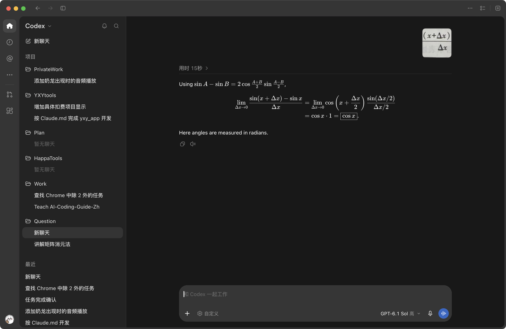

# 题目讲解 · 2026-10-19_14-04-41

- 记录时间：2026-10-19 14:04:41
- 时区：Asia/Shanghai（UTC+08:00）
- 原图：`photo/2026-10-19_14-04-41.png`
- Notion 同步状态：已同步；已回读核对本次题干、解析、四层嵌套及公式。
- Notion 页面：[local-question-bank](https://app.notion.com/p/3e4867d026d980a9b79ce8eeb831631a)，位置为 2026年 → 10月 → 19日 → 第 2026-10-19_14-04-41 题 · 题干/解析。

## 第 2026-10-19_14-04-41 题

### 原题与题图

截图主体是一段已有解答，没有显示完整原始题干和题号。依据主体中清晰的公式，整理所讨论的问题为：对固定的实数 $x$，求

$$
\lim_{\Delta x\to0}\frac{\sin(x+\Delta x)-\sin x}{\Delta x}.
$$

截图给出和差化积公式

$$
\sin A-\sin B=2\cos\frac{A+B}{2}\sin\frac{A-B}{2},
$$

并据此写出

$$
\begin{aligned}
\lim_{\Delta x\to0}\frac{\sin(x+\Delta x)-\sin x}{\Delta x}
&=\lim_{\Delta x\to0}\cos\left(x+\frac{\Delta x}{2}\right)\frac{\sin(\Delta x/2)}{\Delta x/2}\\
&=\cos x\cdot1=\cos x.
\end{aligned}
$$

末尾英文说明角度采用弧度制。右上角的小题图只显示局部，不能从中恢复完整原始题干；本次解析以主体清晰的表达式为依据。界面上的其他聊天标题不属于题目材料。

### 条件与前提检查

- $x$ 是固定的任意实数；$\Delta x$ 是 $x$ 的增量，作为整体符号理解，可以为正或负。
- 求极限时取 $\Delta x\ne0$，使分母有意义；允许它无限接近 $0$。
- 角度采用弧度制，因此可以使用基本极限 $\lim_{t\to0}\sin t/t=1$。
- 主体中各步等式成立，结论正确。计算这个清晰可见的表达式无需补充条件。

### 解题思路

已知 $x$ 固定、$\Delta x\to0$，要求函数值变化量与自变量变化量之比的极限。

直接令 $\Delta x=0$ 会得到 $0/0$，这是未定式，无法据此判断答案。先用和差化积把两个正弦的差写成乘积，再把分母凑成正弦里面的 $\Delta x/2$，就能使用基本极限。

这个比值也叫“差商”，表示区间两端的平均变化率；它在增量趋于零时的极限，就是导数。

### 详细解析

**第一步：把分子用和差化积展开。**

在公式中取 $A=x+\Delta x$、$B=x$，则

$$
\frac{A+B}{2}=x+\frac{\Delta x}{2},\qquad
\frac{A-B}{2}=\frac{\Delta x}{2}.
$$

所以

$$
\sin(x+\Delta x)-\sin x
=2\cos\left(x+\frac{\Delta x}{2}\right)\sin\frac{\Delta x}{2}.
$$

**第二步：整理分母，凑出基本极限。**

把上式除以 $\Delta x$：

$$
\frac{\sin(x+\Delta x)-\sin x}{\Delta x}
=\cos\left(x+\frac{\Delta x}{2}\right)\frac{2\sin(\Delta x/2)}{\Delta x}.
$$

注意 $\Delta x=2(\Delta x/2)$，因此

$$
\frac{2\sin(\Delta x/2)}{\Delta x}
=\frac{2\sin(\Delta x/2)}{2(\Delta x/2)}
=\frac{\sin(\Delta x/2)}{\Delta x/2}.
$$

这样处理后，正弦的自变量与分母相同。分子中的系数 $2$ 被约掉了。

**第三步：分别计算两个因子的极限。**

因为 $x$ 固定，且余弦函数连续，所以

$$
\lim_{\Delta x\to0}\cos\left(x+\frac{\Delta x}{2}\right)=\cos x.
$$

对另一个因子，令 $t=\Delta x/2$。当 $\Delta x\to0$ 时，$t\to0$，由基本极限得到

$$
\lim_{\Delta x\to0}\frac{\sin(\Delta x/2)}{\Delta x/2}
=\lim_{t\to0}\frac{\sin t}{t}=1.
$$

这里引用的是可以独立用几何夹逼证明的基本极限，无需预先使用正弦函数的导数。

两个因子的极限均存在且有限，可以使用乘积的极限法则：

$$
\lim_{\Delta x\to0}\frac{\sin(x+\Delta x)-\sin x}{\Delta x}
=\cos x\cdot1=\cos x.
$$

### 最终答案

$$
\boxed{\lim_{\Delta x\to0}\frac{\sin(x+\Delta x)-\sin x}{\Delta x}=\cos x},\qquad x\in\mathbb R.
$$

这也证明了弧度制下 $f(x)=\sin x$ 的导数为 $f'(x)=\cos x$。

### 检验与易错点

- 取 $x=0$，原式为 $\lim_{\Delta x\to0}\sin(\Delta x)/\Delta x=1$，与 $\cos0=1$ 一致。
- 取 $x=\pi/2$，原差商为 $(\cos\Delta x-1)/\Delta x=-\sin(\Delta x/2)\,[\sin(\Delta x/2)/(\Delta x/2)]$，极限为 $0$，与 $\cos(\pi/2)=0$ 一致。
- 基本极限对左右两侧都成立，因此本题的双侧极限存在。
- $\Delta x$ 是一个增量符号；当 $x=0$ 时，$\Delta x$ 仍可以取非零值。
- $\sin(\Delta x/2)/(\Delta x/2)$ 的分子、分母同时趋于零，但比值趋于 $1$，不能直接把它写成 $0/0$ 后进行运算。
- 在增量非零时，差商通常不等于 $\cos x$；等式 $\cos x$ 是求极限后得到的结论。
- 弧度制是关键前提；若自变量按度数计，导数会出现角度换算因子。
